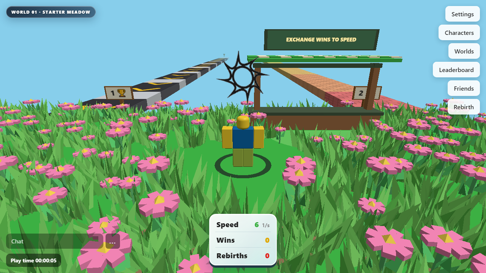
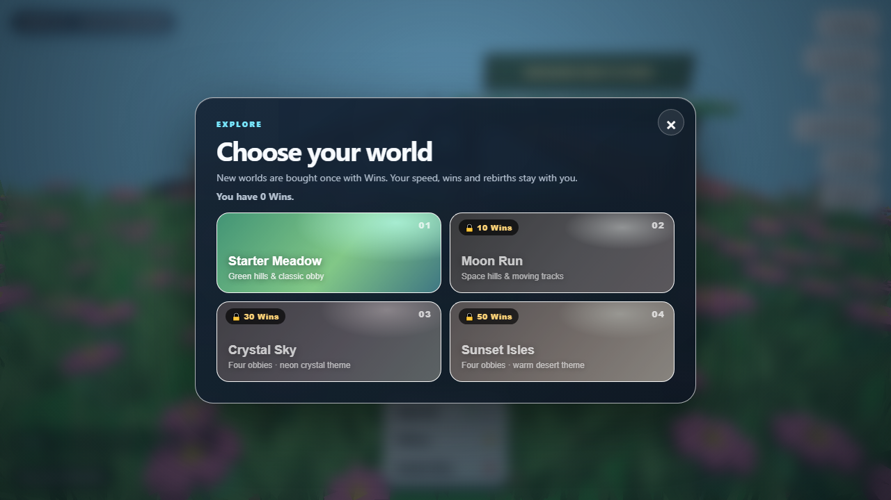
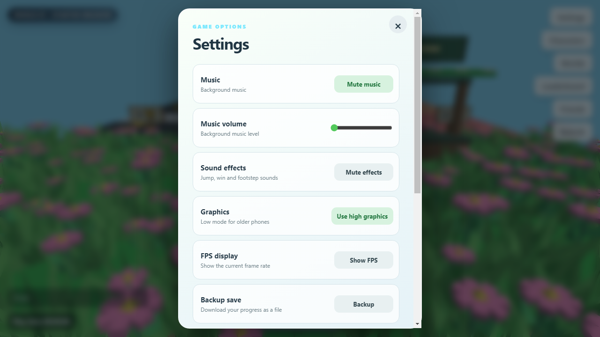
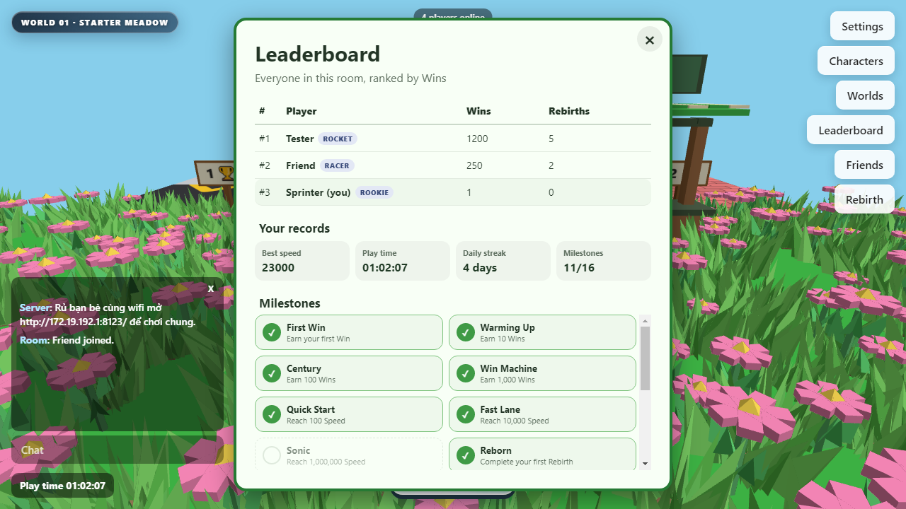
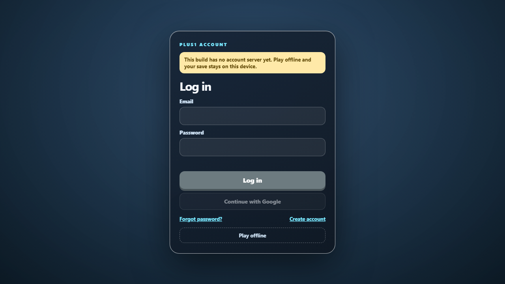

# +1 Speed

Game 3D chạy trên nền web (Three.js): chạy liên tục để Speed tự tăng **+1 mỗi giây**, né chướng ngại vật, mua 4 thế giới bằng Wins, rebirth để tăng tốc độ kiếm điểm và chơi LAN nhiều người.



## Tính năng

- **4 thế giới**: Starter Meadow (mặc định), Moon Run (10 Wins), Crystal Sky (30 Wins), Sunset Isles (50 Wins) — mỗi world có đường đua và obby riêng.
- **Speed tự tăng**: cứ mỗi giây sống sót là Speed +1 (tăng theo Wins và Rebirths); hết Speed khi va chướng ngại vật thì hồi sinh tại spawn.
- **Exchange Wins to Speed**, shop phụ kiện, bảng Characters, Leaderboard và Rebirth.
- **Điểm danh hằng ngày**: mỗi ngày vào game lần đầu được +Wins, chuỗi ngày liên tiếp tăng dần (tối đa +5 Wins/ngày, nghỉ 1 ngày là mất chuỗi).
- **16 thành tích (milestones)**: mốc Wins, Speed, Rebirth, mở world, kết bạn, chơi đủ 1 giờ… — mở khoá vĩnh viễn, xem trong bảng Leaderboard.
- **Leaderboard theo phòng**: xếp hạng mọi người đang online theo Wins, kèm danh hiệu theo số lần Rebirth (Racer → Speedster → Rocket → Legend).
- **Chế độ đồ hoạ thấp** cho máy yếu, tự bật khi máy chỉ có ≤2 GB RAM / 2 nhân hoặc khi FPS trung bình dưới 35 trong 5 giây đầu.
- **LAN multiplayer**: nhiều người chơi cùng wifi, chat, bubble chat, danh sách người chơi, báo người vào/rời phòng.
- **Lưu tiến trình tự động** mỗi giây, kèm **Backup/Restore** ra file JSON.
- **Tài khoản** (khi cấu hình Supabase): đăng nhập/đăng ký, quên mật khẩu bằng mã 6 số gửi qua Gmail, đổi mật khẩu, liên kết Google, xoá tài khoản, đồng bộ save lên cloud. Chưa cấu hình thì vẫn chơi offline bình thường.

| Chọn world | Settings |
| --- | --- |
|  |  |

| Leaderboard | Đăng nhập |
| --- | --- |
|  |  |

## Điều khiển

| Hành động | Bàn phím | Cảm ứng |
| --- | --- | --- |
| Di chuyển | `W A S D` hoặc phím mũi tên | joystick bên trái |
| Nhảy | `Space` | nút Jump |
| Đi chậm | giữ `Shift` | kéo joystick nhẹ |
| Chat | `Enter` hoặc `/` | ô Chat dưới màn hình |

## Tải về

Vào tab **Releases** của repo và chọn file theo nền tảng:

| Nền tảng | File tải về | Ghi chú |
| --- | --- | --- |
| Windows | `Plus1Speed-Setup-<version>.exe` | Bộ cài, chạy được Windows 7/8.1/10/11 (Electron 22) |
| Linux Mint 22.3 XFCE / Ubuntu 24.04 | `Plus1Speed-<version>-amd64.deb` | Cách dễ nhất, xem hướng dẫn bên dưới |
| Linux Mint 22.3 XFCE / Ubuntu 24.04 | `Plus1Speed-<version>-x86_64.AppImage` | Chạy không cần cài, cần thêm `libfuse2t64` |
| Android | `Plus1Speed-<version>.apk` | Bật "Cài từ nguồn không xác định" trước khi cài; máy Android cũ cần cập nhật **Android System WebView** trong CH Play |

Bản Android hiện chỉ chơi đơn (chưa có server LAN đi kèm), nhưng có thể vào LAN server của PC bằng nút **LAN**.

### Linux Mint XFCE 22.3

**Cách 1 — file `.deb` (khuyên dùng):**

```bash
sudo apt install ./Plus1Speed-<version>-amd64.deb
plus1-speed            # hoặc mở "+1 Speed" trong menu Game
```

Gỡ ra: `sudo apt remove plus1-speed`.

**Cách 2 — AppImage:**

```bash
sudo apt install libfuse2t64     # Mint 22.x đổi tên từ libfuse2
chmod +x Plus1Speed-<version>-x86_64.AppImage
./Plus1Speed-<version>-x86_64.AppImage
```

Nếu AppImage báo `SUID sandbox helper binary was found` hoặc thoát ngay, chạy kèm cờ:

```bash
./Plus1Speed-<version>-x86_64.AppImage --no-sandbox
```

Bản AppImage tự thêm cờ này khi khởi động (Mint 22.x chặn user-namespace nên sandbox của Electron 22 không chạy được), nhưng nếu máy vẫn báo lỗi thì dùng lệnh trên. Máy không có `libfuse2t64` cũng có thể chạy:

```bash
./Plus1Speed-<version>-x86_64.AppImage --appimage-extract-and-run --no-sandbox
```

Game cần GTK3 + trình điều khiển GL; XFCE mặc định có sẵn. Nếu màn hình chỉ hiện "Máy này không tạo được WebGL", cài driver Mesa: `sudo apt install mesa-utils` rồi chạy `glxinfo -B` để kiểm tra.

### Chơi chung trong cùng wifi

- Máy chạy bản Windows/Linux mở game trước — game tự mở server ở cổng **8000** (nếu bận sẽ tự đổi sang 8001, 8002…).
- Máy khác mở trình duyệt tới `http://<IP-máy-host>:8000` để vào chung.
- IP máy host xem bằng `ipconfig` (Windows) hoặc `ip addr` (Linux).
- Trên Android: mở **LAN**, nhập `IP:8000` của PC để vào phòng.

## Tài khoản và lưu game

- Tiến trình được lưu trong bộ nhớ trình duyệt và file riêng của game, tự ghi mỗi giây.
- **Settings → Backup save** tải file `plus1-speed-save-*.json`; **Restore save** nạp lại từ file đó (hỏi xác nhận trước khi ghi đè).
- Muốn bật tài khoản cloud: tạo project Supabase rồi làm theo [supabase/README.md](supabase/README.md) và điền `js-pack/supabase-config.js`.

## Chạy từ source

Yêu cầu Node.js 18+.

```bash
npm install
npm start          # mở app Electron
npm run dist:win   # tạo bộ cài Windows trong release/
npm run dist:linux # tạo AppImage + deb (chạy trên Linux)
npm run android:sync
```

Bản Android cần Android SDK + Java 17 để build bằng Gradle trong thư mục `android/`.

## Phát hành bản mới

Workflow `.github/workflows/release.yml` tự build cả 3 nền tảng khi đẩy tag:

```bash
git tag v1.5.0
git push origin v1.5.0
```

GitHub Actions sẽ build Windows, Linux, Android rồi gắn file vào GitHub Release.

## Changelog

### v1.5.0 (2026-11-05)
- Settings có thêm thanh chỉnh âm lượng hiệu ứng (tiếng bước chân, nhảy, win, rebirth), tách riêng với âm lượng nhạc.
- Nút **Random** trong bảng Characters để đổi nhân vật ngẫu nhiên.
- Thông báo **New best speed** khi lần đầu phá kỷ lục Speed trong phiên chơi.
- Sửa lỗi âm lượng nhạc và hiệu ứng bị đặt về 0 với người chơi mới (chưa từng lưu cài đặt).
- Sửa lỗi nhân vật vừa chọn bị đổi ngược lại sau vài giây.

### v1.4.0 (2026-11-05)
- Chạy được trên máy chỉ có WebGL 1 (điện thoại Android cũ như Oppo Neo 7s): hạ Three.js xuống r152.2, tạo renderer với nhiều mức cấu hình, báo lỗi rõ ràng nếu máy không có WebGL.
- Bản Linux hỗ trợ Linux Mint 22.3 XFCE: AppImage tự tắt sandbox khi chạy (Mint chặn user-namespace), hướng dẫn cài `.deb`/`libfuse2t64` trong README.
- Điểm danh hằng ngày: +1 đến +5 Wins mỗi ngày, giữ chuỗi để tăng thưởng.
- 16 thành tích mở khoá vĩnh viễn, hiện trong bảng Leaderboard; thông báo khi đạt mốc.
- Leaderboard đổi thành bảng xếp hạng cả phòng theo Wins, kèm danh hiệu theo Rebirth và kỷ lục cá nhân (Speed cao nhất, giờ chơi, chuỗi ngày).

### v1.3.0 (2026-11-04)
- Settings mới: âm lượng nhạc, tắt/bật hiệu ứng âm thanh riêng, hiện FPS, chọn đồ hoạ thấp/cao.
- Save system: tự lưu mỗi giây, thêm Backup/Restore ra file.
- Multiplayer: hiện số người trong phòng, danh sách người chơi, thông báo vào/rời phòng, đồng bộ Wins/Rebirths.
- Hệ thống tài khoản: đăng nhập/đăng ký, quên mật khẩu bằng mã 6 số, đổi mật khẩu, liên kết Google, xoá tài khoản, đồng bộ save cloud (cần cấu hình Supabase).
- Tự nhận diện máy yếu để bật đồ hoạ thấp; bỏ VIP và cổng VIP.
- Giảm dung lượng: model nhân vật 37 MB → 8.7 MB (texture WebP, bỏ morph thừa), bỏ file nhạc và ảnh không dùng — bộ cài nhẹ hơn khoảng 15–20 MB.

### v1.2.1
- Sửa màn hình tạo profile trên điện thoại nằm ngang (nút **Start playing** bị che).

### v1.2.0
- Bản Android (APK), auto-update cho Electron, thông báo bản mới trên Android.

### v1.1.0
- LAN multiplayer, chat, bảng Friends, AFK tag, lưu tiến trình tự động.

### v1.0.0
- Bản phát hành đầu tiên: 4 thế giới, shop, rebirth, leaderboard.

## Lưu ý

Một số mô hình nhân vật (SpongeBob, Mario, Roblox…) lấy từ internet, chỉ phù hợp dùng cá nhân — cân nhắc thay bằng asset tự tạo trước khi phát hành công khai.
